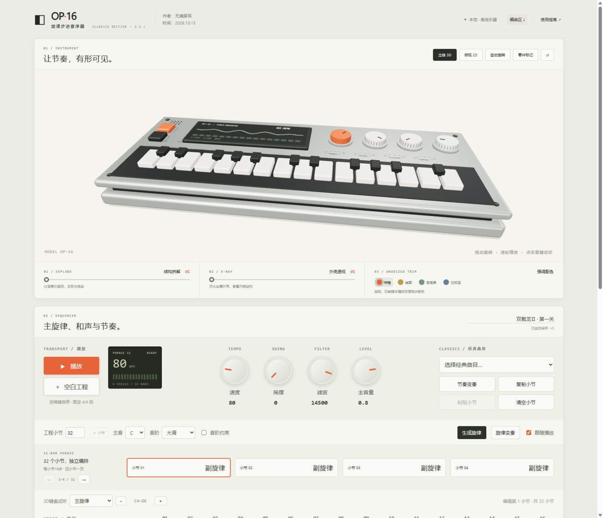
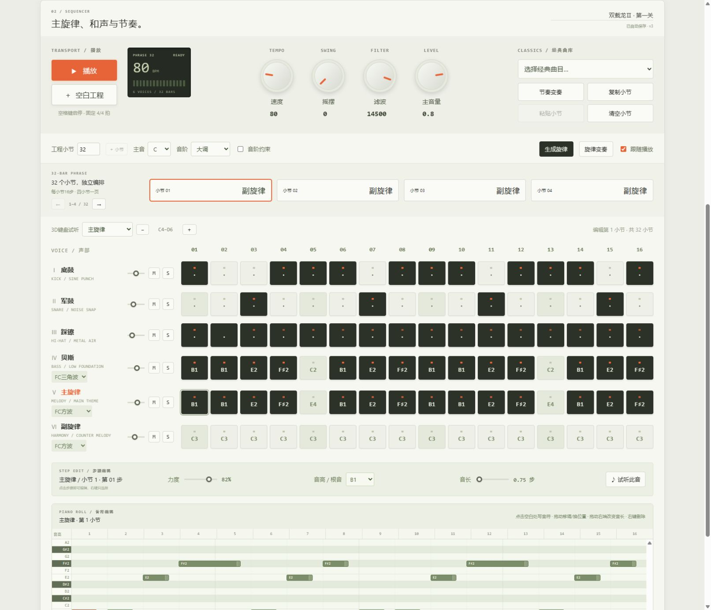

**English** | [简体中文](README.zh-CN.md)

<div align="center">

# OP·16 · Electronic Step Sequencer

**See your rhythm take shape.**

Six-part composition · Piano roll · Browser synthesis · Interactive 3D instrument

## 🌐 [Try the web app — no installation needed](https://op16-field-sequencer.breezysquid.chatgpt.site/)

**[Play online →](https://op16-field-sequencer.breezysquid.chatgpt.site/)　|　[User guide](docs/USER_GUIDE.en.md)　|　[Product overview](docs/PRODUCT.en.md)**

Created by **无痛穿耳** · Created **2026.10.15** · Version **2.2.1**

</div>

> **New here?** Open the web app and click **播放 (Play)** to hear the complete boss-battle demo. Edit its notes, change the sounds, then download your work as a WAV file or an editable project. The app interface is currently in Chinese; this repository provides English documentation.



## What is OP·16?

OP·16 combines a step sequencer with an interactive 3D electronic instrument. Turn knobs, press keys and watch the selected part play, or open the piano roll to edit individual melody notes.

It is designed for learning electronic music, exploring rhythm and melody, experimenting with chiptune sounds, and demonstrating sound and interaction design. Start in your browser without an account, audio plugins or a music workstation.

## Features

| Feature | What you can do |
| --- | --- |
| Six musical parts | Arrange kick, snare, hi-hat, bass, lead, and either chords or an independent countermelody |
| Complete phrases | Use 16 steps per bar; the boss-battle demo has 24 bars and 384 steps, the four classic-library excerpts each have 32 bars |
| Piano roll | Click to add notes, drag to change pitch or position, resize the right edge for duration, and right-click to delete |
| Melody and harmony | Set the root and scale, constrain notes to the scale, edit chord degrees, and generate or vary melodies with local rules |
| Synthesized sounds | Choose square wave, triangle wave, electric piano, plucked sounds, synth bass, pads and more |
| Interactive 3D | Rotate the device, switch to a top view, separate its layers, see through the enclosure, change colors and watch note-driven key feedback |
| Project management | Use browser autosave, JSON import/export, undo/redo, and bar copy/paste |
| Audio export | Export 1–32 bars as 44.1 kHz, 16-bit stereo WAV |



## Get started in three steps

1. **Open the web app and click 播放 (Play).** This click enables browser audio.
2. **Choose a part or bar and edit notes.** Edit bass and melody parts in the piano roll. Use the left/right arrows to navigate the 24-bar demo, four bars at a time.
3. **Save your work.** Download a project file to continue editing later, or export a WAV file.

Select **赤影战士 · Boss 战 (Shadow of the Ninja · Boss Battle)** in the preset list to restore the original demo. The classic library also includes **超级魂斗罗 · 第一关 (Super C · Stage 1)**, **双截龙Ⅱ · 第一关 (Double Dragon II · Mission 1)**, **赤色要塞 · 第一关 (Jackal · Stage 1)** and **恶魔城 · Vampire Killer (Castlevania)**, each arranged as a 32-bar excerpt. Click **空白工程 (Blank Project)** below Play to start from scratch. Set the project length or add bars, up to 32. See the [classic library notes](docs/CLASSIC_LIBRARY.md).

## Storage and limitations

Audio is synthesized in each visitor's browser. Projects are autosaved in that browser, independently of other users. Autosave does not sync across devices and may be lost when browser data is cleared. Download a JSON project as a backup.

The first page load requires a network connection. Full offline caching and PWA installation are not currently available. Background playback depends on the browser and operating system; foreground use is recommended. The 3D view requires WebGL2. Mobile behavior and professional audio-interface latency have not been comprehensively validated.

General MIDI import/export, VST plugins, sung vocals and complete DAW projects are not supported. Melody tracks preserve independently timed notes within a step, including triplets. Standard chord mode creates triads from a root note; the piano roll remains a lightweight editor rather than a full DAW.

## Run locally

Use **Node.js 22.12 or later**.

```bash
npm ci
npm run dev
```

Open the local URL shown in your terminal. To check and build the project:

```bash
npm test
npm run build
npm run preview
```

The production output is written to `dist/` and can be deployed to static hosting with HTTPS. Assets use relative paths, including when hosted in a subdirectory. The live demo is hosted separately; **this repository does not automatically serve it through GitHub Pages**.

### Optional: build the Windows desktop app

On Windows, install the .NET 8 SDK, build the web app first, then run:

```powershell
dotnet publish desktop/OP16.Desktop.csproj -c Release -r win-x64 --self-contained true -o release
```

The desktop app requires Microsoft Edge WebView2 Runtime. Keep all files in the publish directory together. Web and desktop projects use different storage locations; transfer work between them with JSON project files.

## Technology and layout

The frontend uses vanilla JavaScript, Vite and Three.js. Web Audio synthesizes the sounds, with a Worker and the audio clock handling scheduling. The 3D model is generated in code and needs no external model files. The optional Windows host uses .NET 8, WPF and WebView2.

```text
src/          UI, arrangement data, synthesis, 3D device and piano roll
public/       Icons and other static assets
desktop/      Optional Windows desktop host source
docs/         Product overview, guides and interface reference images
tests/        Demo score and project data checks
```

## Demo music and third-party components

The **Shadow of the Ninja · Boss Battle** demo reconstructs Herr Dethnout's 2017 MIDI arrangement to demonstrate two melodies, bass and drums. It is a synthesized rendition, rather than an FC/NES soundtrack recording or a cycle-accurate hardware emulation. Music and game rights belong to their respective rights holders. Public availability of the application source does not grant commercial rights to the music.

See [THIRD-PARTY-NOTICES.md](THIRD-PARTY-NOTICES.md) for component versions, music attribution and license notices. No open-source license has been designated for the application's own code.

## Feedback

Please use this repository's Issues to report problems. Include your browser and operating system, steps to reproduce, and the affected bar or action. Share projects containing your own creative work only if you wish to make them public.

### Random accompaniment

Create a **Blank project**, then click **随机伴奏 (Random accompaniment)** beside the sound controls. Each click generates a different drum, bass and chord arrangement across all project bars (up to 32), preserving your lead melody, harmony progression, tempo and mixer. Choose Pop, Rock, Funk, Electronic Dance, Hip-hop, Latin or FC Chiptune in the style selector, or keep Random Style. Repeated clicks produce variations within the selected style; the selection is saved with the project. Chiptune uses FC triangle bass and pulse chords. Undo restores the previous arrangement. The action is disabled for classic scores.
