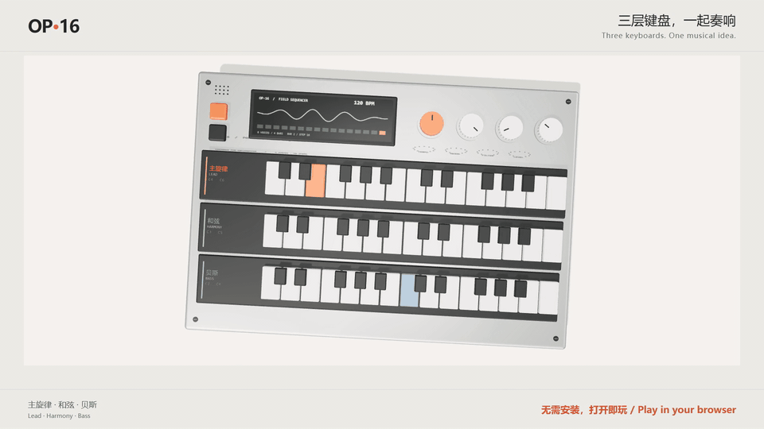
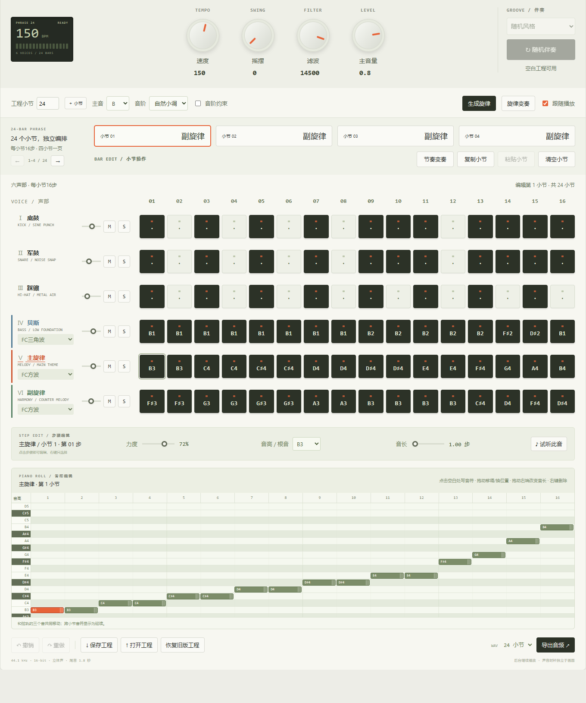

[English](README.md) | **简体中文**

<div align="center">

# OP·16 · 电子步进音序器

**让节奏，有形可见。**

三层键盘 · 六声部编排 · 钢琴卷帘 · FC经典曲库

## 🌐 [立即打开网页版，无需安装或注册](https://op16-field-sequencer.breezysquid.chatgpt.site/)

**[使用指南](docs/USER_GUIDE.md) · [产品介绍](docs/PRODUCT.md) · [Windows桌面版](docs/WINDOWS.md) · [更新记录](CHANGELOG.md)**

作者：**无痛穿耳** · 创作日期：**2026.10.15** · 版本：**2.2.3** · 更新日期：**2026.10.18**

</div>

> 点击“播放”聆听完整经典编曲，修改音符，或新建空白工程、选择风格生成伴奏。作品可保存为JSON工程或导出立体声WAV。应用界面为中文，仓库提供中英文说明。

[](https://github.com/power32m/Electronic-Step-Sequencer/releases/download/v2.2.1/OP16-demo-20s.mp4)

**[20秒有声演示（MP4）](https://github.com/power32m/Electronic-Step-Sequencer/releases/download/v2.2.1/OP16-demo-20s.mp4)** · 上方动图无声，点击打开完整视频。

## 这是什么

OP·16 是一款轻量电子乐器和步进音序器。三层键盘同时显示主旋律、副旋律／和弦与贝斯，六轨网格和钢琴卷帘用于修改编曲。声音和3D模型在本机生成，适合节奏练习、理解声部配合，以及芯片音乐实验。

## 能做什么

| 区域 | 当前功能 |
| --- | --- |
| 三层键盘 | 主旋律橙色、副旋律／和弦绿色、贝斯蓝色；同步亮键，按全曲自动适配音域，各层独立试听 |
| 视角 | 默认2D锁定旋转和缩放，便于点键；3D支持旋转、缩放和自动旋转 |
| 六声部 | 底鼓、军鼓、踩镲、贝斯、主旋律、副旋律／和弦；每小节16步，四小节分页，独立音量、静音与独奏 |
| 播放定位 | 吸顶播放栏、暂停续播、小节跳转、从当前编辑小节播放、回到开头 |
| 音符编辑 | 钢琴卷帘、音高、力度、音长、步内独立音符、撤销重做和小节复制粘贴 |
| 旋律与和声 | 主音、音阶约束、和弦级数、本地规则旋律生成及变奏 |
| 风格伴奏 | 流行、摇滚、放克、电子舞曲、嘻哈、拉丁、FC芯片及随机风格；空白工程可反复生成变化 |
| 声音与导出 | 后台Worker准备音源，缓存复用；WAV导出显示进度并可取消 |
| 工程管理 | 本地自动保存、JSON导入导出、v1/v2/v3兼容；网页版和更新后的Windows版导入上限均为4MB |



## 经典曲库

以下是**所列MIDI的完整六声部改编**，保留选定声部的原时间线及已有重复段落；为合成演奏，不是游戏原声录音。

| 案例 | 小节 | BPM |
| --- | ---: | ---: |
| 赤影战士 | 24 | 150 |
| 恶魔城 | 48 | 127 |
| 超级马里奥 | 37 | 105 |
| 赤色要塞 | 34 | 80 |
| 魂斗罗 | 46 | 110 |
| 洛克人Ⅱ | 113 | 180 |
| 忍者龙剑传 | 84 | 150 |
| 塞尔达传说 | 24 | 148 |
| 沙罗曼蛇 | 38 | 142 |
| 最终幻想6 | 110 | 205 |
首次启动默认载入Boss案例，后续可恢复自动保存。经典曲目支持完整播放、编辑和导出。空白工程从4小节起步，可调整为1–32小节。来源与编配取舍见[曲库说明](docs/CLASSIC_LIBRARY.md)。

## 开始使用

1. **听音乐：** 选曲后点击“播放”，再次点击暂停，“继续”接着播放。下滑编曲时，播放栏仍在顶部。
2. **改音符：** 选择小节和声部，在步骤格或钢琴卷帘编辑；小节操作紧邻四小节分页。
3. **做自己的作品：** 点击播放下方的“空白工程”，选风格并生成“随机伴奏”，再写入或生成主旋律。反复点击产生不同伴奏，支持撤销。
4. **保存作品：** 保存JSON继续编辑，或导出WAV。导出另留1.8秒尾音，长曲渲染需要等待。

## 网页版与Windows版

| | 网页版 | Windows桌面版 |
| --- | --- | --- |
| 启动 | [直接在线体验](https://op16-field-sequencer.breezysquid.chatgpt.site/) | [下载Windows x64](https://github.com/power32m/Electronic-Step-Sequencer/releases/tag/v2.2.2) · [使用说明](docs/WINDOWS.md) |
| 网络 | 首次加载需联网，尚无完整离线缓存／PWA | 资源随包可离线运行，须已安装WebView2运行时 |
| 自动保存 | 当前浏览器配置和站点 | 原本机 `OP16/WebView` 配置目录 |
| 工程迁移 | 保存／打开JSON | 保存／打开JSON |

网站、源码和本地Windows正式版现为 **2.2.3（2026-10-18）**，包含实际音频示波器、随版本更新的发布日期和此前的渲染清理。已用真实浏览器验证播放、暂停续播、静音、切换曲目及琴键试听，并通过42项自动检查。

**公开Windows下载包仍为v2.2.2**，已包含10首曲目，但早于本次示波器更新；自行构建当前源码可获得2.2.3。

**[下载Windows x64 ZIP](https://github.com/power32m/Electronic-Step-Sequencer/releases/tag/v2.2.2)**，解压后运行 `OP16电子步进音序器.exe`，同页附SHA-256校验文件。 自行构建时，请保留整个发布目录。

自动保存不在浏览器、设备和桌面版之间同步。清理浏览器数据或替换工程前，请先下载JSON备份。后台播放受系统和浏览器限制，乐器展示需要支持WebGL2的现代浏览器，精细编曲建议使用桌面端。

当前不提供通用MIDI导入／输出、VST、音频录制、人声或云端工程库。普通和弦模式生成三和弦，不是完整DAW或任意复音编辑器。

## 本机运行与构建

需要 **Node.js 22.12或更高版本**：

```bash
npm ci
npm run dev
```

检查和构建：

```bash
npm test
npm run build
npm run preview
```

产物在 `dist/`，可部署到HTTPS静态托管，资源相对路径支持子目录。在线体验由独立站点托管，**不是GitHub Pages自动托管页面**。WPF/WebView2构建见[Windows指南](docs/WINDOWS.md)。

## 技术与目录

原生JavaScript、Vite、Three.js与Web Audio。`synth-worker.js` 在后台准备音源缓冲，音频时钟和ticker调度播放。Windows使用.NET 8、WPF与WebView2。

```text
src/       界面、工程、经典曲谱、音源、三层乐器和钢琴卷帘
desktop/   Windows宿主源码
docs/      中英文产品、使用及桌面版指南，当前界面配图
tests/     曲谱完整性、工程兼容、伴奏及键盘检查
public/    静态资源
```

## 来源与反馈

音乐与游戏权利归相应权利人，源码公开不表示获得音乐商业使用授权。参阅[音乐来源](docs/CLASSIC_LIBRARY.md)和[第三方说明](THIRD-PARTY-NOTICES.md)。应用自有代码尚未指定开源许可证。

欢迎在[Issues](https://github.com/power32m/Electronic-Step-Sequencer/issues)反馈，说明浏览器／系统、复现步骤和相关小节；个人工程文件请自行决定是否公开。
