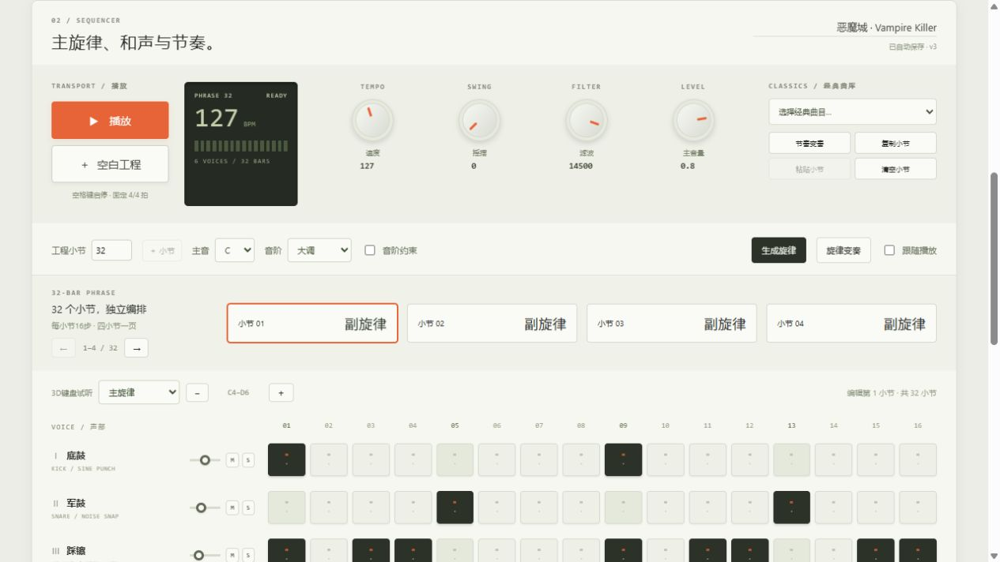

# Classic library / 经典曲库

Four 32-bar excerpts at their source MIDI tempos. These are synthesized adaptations of fan arrangements, not original soundtrack recordings. All clips start at the beginning of the selected MIDI and end at bar 32; note tails are trimmed at the boundary.

四首曲目保留原 MIDI 速度，取开头32小节；末尾音符在边界裁切。以六声部合成演奏呈现，移除了重复配器和回声层。

| Track / 曲目 | Tempo | Events | MIDI arrangement |
| --- | --- | --- | --- |
| 超级魂斗罗 · 第一关 | 150 BPM | 1151 | [VGMusic contributor (not listed in index)](https://www.vgmusic.com/music/console/nintendo/nes/Level_1.mid) |
| 双截龙Ⅱ · 第一关 | 80 BPM | 1947 | [Stockman](https://www.vgmusic.com/music/console/nintendo/nes/dd2-mission1.mid) |
| 赤色要塞 · 第一关 | 80 BPM | 1774 | [Stevenm9; edited and updated by Keio](https://www.vgmusic.com/music/console/nintendo/nes/jackal.mid) |
| 恶魔城 · Vampire Killer | 127 BPM | 1128 | [Jorge D. Fuentes](https://www.vgmusic.com/music/console/nintendo/nes/CV1-_Vampire_Killer.mid) |

Super C uses melody tracks 1/2, bass 8 and drums 10; doubled orchestral layers are omitted. Double Dragon II uses melody 2, counterline 4, bass 1 and drums 5; echo track 3 is omitted. Jackal uses tracks 1/2/3; doubled tracks 5/6/7 are omitted and the source has no separate drum part. Castlevania uses tracks 1/2/3/6; echo tracks 4/5 are omitted. Source track numbers are zero-based.

The Super C index does not name its sequencer; no attribution is invented. The Jackal file credits Stevenm9 and Keio. Music and game rights remain with their respective owners. MIDI availability does not grant redistribution or commercial music rights.

[English home](../README.md) | [中文首页](../README.zh-CN.md)
