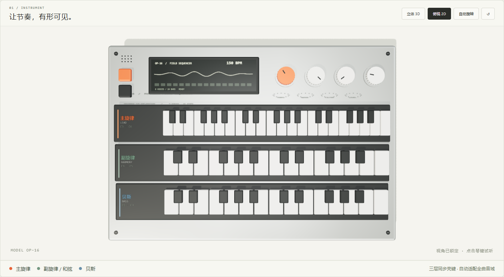

**English** | [简体中文](PRODUCT.md) | [Home](../README.md)

# OP·16 — Product overview

## 🌐 [Try the web app](https://op16-field-sequencer.breezysquid.chatgpt.site/)

**Watch the parts on three keyboards. Edit the music on six tracks.** Click **播放 (Play)** to start with a complete arrangement. The interface is Chinese.

Created by 无痛穿耳 · Created 2026.10.15 · Version 2.2.2 · Updated 2026.10.17

## See how the parts form a piece

OP·16 combines a step sequencer with three stacked keyboards. The upper orange layer shows lead, the middle green layer shows countermelody or chords, and the lower blue layer shows bass. All three respond together; chords illuminate their component notes, and each layer covers its full score range automatically.

The default 2D top view locks angle and zoom for precise clicks. Switch to 3D to rotate, zoom or enable auto-rotation. Click a key to audition that layer's sound. Warm off-white surfaces, a metal enclosure and dark keybeds frame the instrument; matching colors identify the tracks below.

## Listen first, then make your own version

Ten complete examples cover Shadow of the Ninja, Castlevania, Super Mario Bros., Jackal, Contra, Mega Man II, Ninja Gaiden, Zelda, Life Force and Final Fantasy VI. These are synthesized six-part adaptations, ranging from 24 to 113 bars. Jackal starts immediately after its silent lead-in is removed; Final Fantasy VI uses the app synthesizer rather than original SFC samples.

Solo the lead, then bring back bass, harmony and drums to compare their roles. Change notes, sounds or tempo and observe the feedback. The sticky player provides pause/continue, bar jumps, playback from the editing bar and rewind while scrolling.

Blank projects start at four bars and support up to 32. Choose Pop, Rock, Funk, Electronic Dance, Hip-hop, Latin or FC Chiptune and generate an accompaniment. Repeated clicks vary the style while preserving the lead. Local-rule melody generation provides another starting point. No AI music service is required.

## Direct editing and portable results

The six-part grid controls drums, bass, lead and countermelody/chords with aligned sound, volume, mute and solo controls. Bar tools sit beside navigation. The piano roll edits pitch, position, velocity and duration, including triplets and short notes within a step.

Save editable JSON or export 44.1 kHz, 16-bit stereo WAV. Export shows progress and can be cancelled; long pieces still take time. Synthesis runs locally, with a voice Worker reducing UI-thread work.

The web app needs no account and requires network for first load. Packaged Windows resources run offline. Projects do not automatically sync between them; transfer JSON files. This repository provides a [Windows desktop download](https://github.com/power32m/Electronic-Step-Sequencer/releases/tag/v2.2.2) and source build instructions.

## Where it fits

- Learning how drums, bass, lead and harmony work together.
- Rewriting classic arrangements or creating short chiptune phrases.
- Teaching or demonstrating sound and interactive instrument design.

OP·16 focuses on lightweight composition. It does not provide recording, VST, general MIDI import/export, unrestricted polyphonic editing or guaranteed professional audio latency. Keep JSON backups; background playback depends on the OS/browser.

See the [user guide](USER_GUIDE.en.md), [Windows guide](WINDOWS.en.md), [music sources](CLASSIC_LIBRARY.md) and [third-party notices](../THIRD-PARTY-NOTICES.md).
